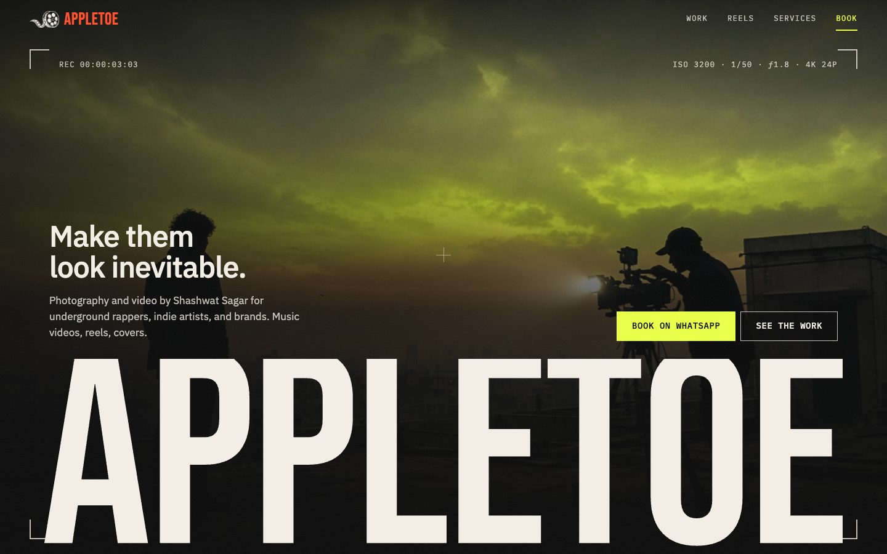
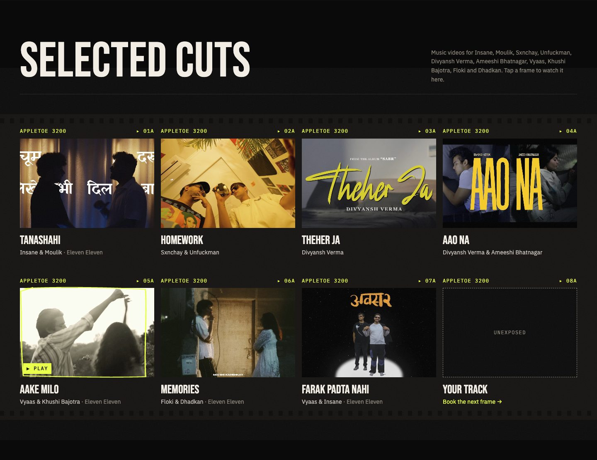
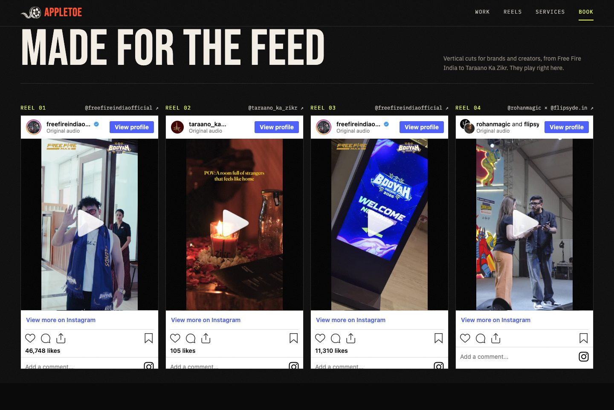
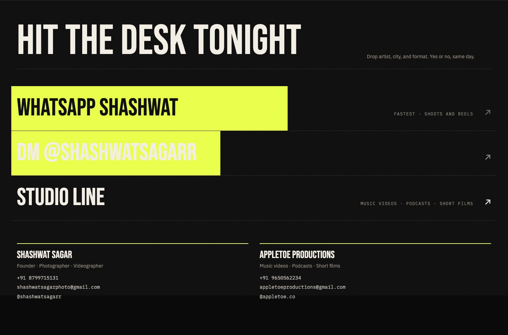
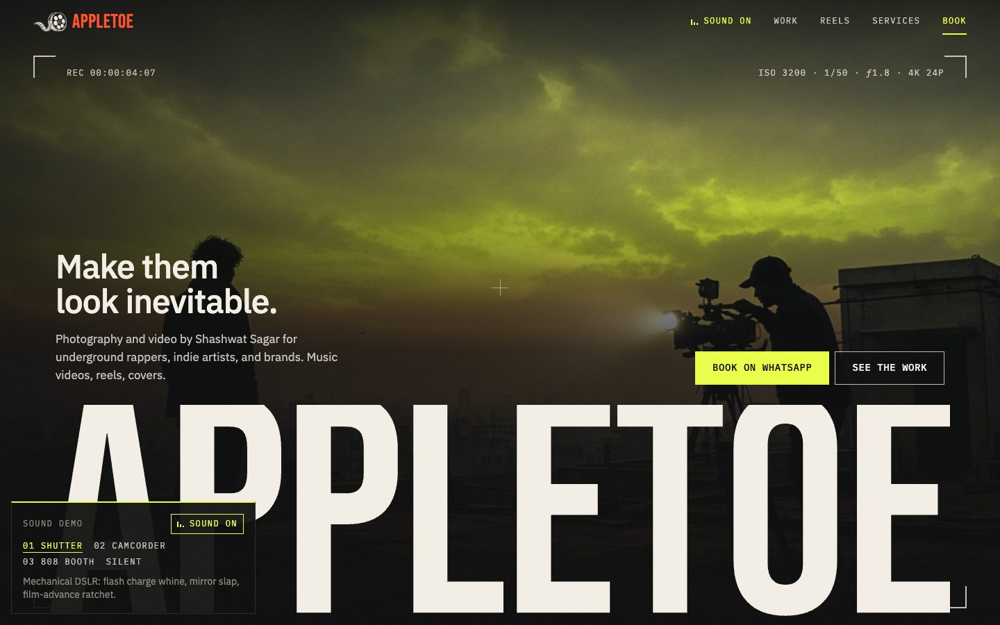
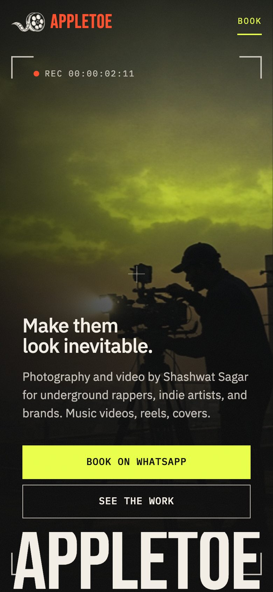
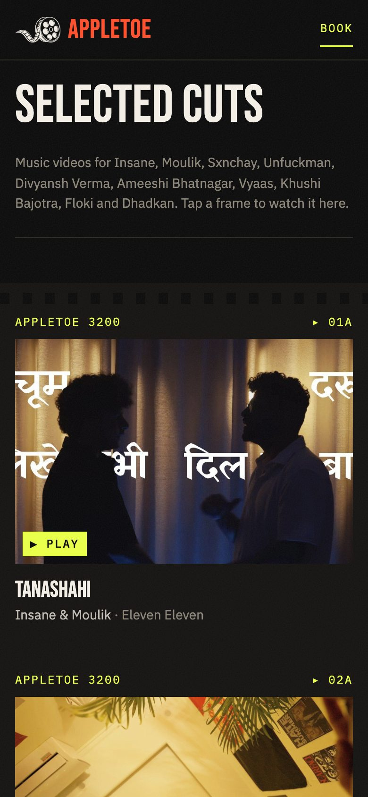

# AppleToe Productions

Landing site for **AppleToe** — photography and videography by Shashwat Sagar for underground artists, reels, music videos, and podcasts.



## Screenshots

| Work (contact sheet) | Reels |
|---|---|
|  |  |
| **Booking** | **Sound demo** |
|  |  |

| Mobile hero | Mobile work |
|---|---|
|  |  |

## Features

- "Raw Cut" brand system (see `brand-spec.md`), tokens in `src/theme/raw-cut.css`
- Full-bleed viewfinder hero with a camera-flash load sequence and live REC timecode
- Contact-sheet work grid with grease-pencil "pick" marks; frames play the music video in an in-page YouTube player
- "Made for the feed" section with embedded Instagram reels
- Service rows that open WhatsApp with the format pre-filled
- Direct booking via WhatsApp, Instagram, and email; sticky book button on mobile
- Sound demos at `/sound/shutter`, `/sound/camcorder`, `/sound/booth` (synthesized with Web Audio, off by default); `/` is silent
- Honors `prefers-reduced-motion`

## Quick start

```bash
npm install
npm run dev
```

Open the URL Vite prints (usually `http://localhost:5173`).

## Scripts

| Command | Description |
|---------|-------------|
| `npm run dev` | Local development server |
| `npm run build` | Production build to `dist/` |
| `npm run preview` | Preview the production build |

## Project structure

```
src/
  pages/Home.tsx    # Main landing page
  pages/Home.css    # Page styles (all values come from theme tokens)
  theme/raw-cut.css # Colors, type, spacing, motion tokens
  sound/            # Web Audio engine + sound packs for the demos
  content.ts        # Brand, services, work, reels, contacts
public/assets/      # Logo and portfolio stills
docs/screenshots/   # README screenshots
```

## Stack

React 19 · Vite · TypeScript · React Router

## Note on assets

Work thumbnails (`public/assets/work/`) and the reel logo (`public/assets/brand/`) are real AppleToe material. The hero still (`public/assets/appletoe-brand/still-hero-reel.png`) is still an AI placeholder; swap in a real high-res frame before launch. Video and reel links live in `src/content.ts`.
